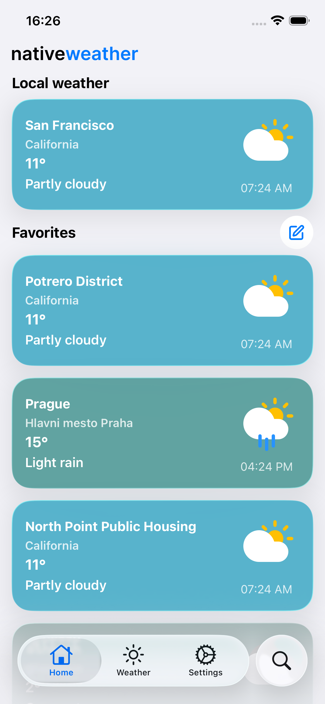
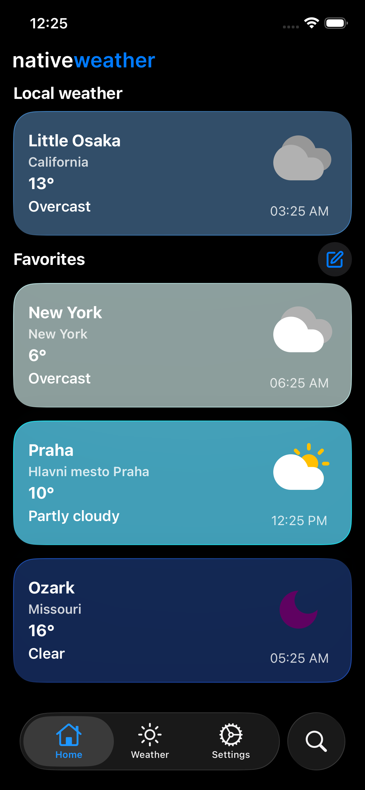
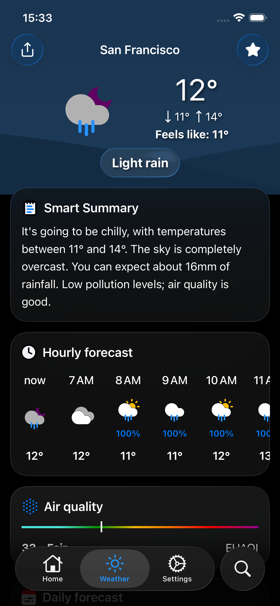

<p align="center">

  <picture>

    <source media="(prefers-color-scheme: dark)" srcset="./assets/logo-dark.png">

    <source media="(prefers-color-scheme: light)" srcset="./assets/logo-light.png">

    

  </picture>

</p>

<div align="center">

[](#) [](https://nativeweather.app/)

<!-- [](https://nativeweather.app/) -->

<!-- [](#) [](#) -->

<!-- [](https://expo.dev/) [](https://nextjs.org/)  -->

[](https://expo.dev/) [](https://nextjs.org/) [](https://react.dev/) [](https://tailwindcss.com/) [](#)

[](https://pnpm.io/) [](https://code.visualstudio.com/)

</div>

<div align="center">


<!--  -->


</div>

<!-- <br/><br/>

<div align="center">

[](#)
[](https://nativeweather.app/)

[](#)
[](https://expo.dev/)
[](https://nextjs.org/)
[](https://react.dev/)
[](https://www.typescriptlang.org/)
[](https://tailwindcss.com/)

[](https://nativeweather.app/)
[](https://pnpm.io/)
[](https://code.visualstudio.com/)

</div> -->

<div align="center">

NativeWeather is a cross-platform weather app for Web and iOS, built with a Turborepo monorepo, Next.js, Expo, React Native, React Native Web, NativeWind, and shared app code.

This started as my first long-term project and has grown into a real weather product with forecasts, air quality, maps, alerts, favorites, local weather, settings, localization, and iOS widgets.

</div>

## Features

- Current weather with condition-based visuals
- 7-day forecast and hourly forecast
- Smart weather summary
- Favorite cities
- Air quality data with EU AQI and US AQI support
- Weather alerts
- Light, dark, and system theme support
- English and Czech localization with Tolgee
- iOS widgets with Expo Widgets

## Tech Stack

- Turborepo
- pnpm workspaces
- Next.js 16
- Expo SDK 55
- React 19
- React Native
- React Native Web
- NativeWind
- React Native MMKV
- Tolgee

## Monorepo Structure

```txt
nativeweather/
├── apps/
│   ├── web/          # Next.js web app
│   └── mobile/       # Expo mobile app
├── packages/
│   └── app/          # Shared app code, components, hooks, storage, API, types
├── package.json
├── pnpm-workspace.yaml
└── turbo.json
```

## Getting Started

Prerequisites

- Node.js
- pnpm
- Xcode for iOS development
- Expo tooling for mobile development

This project uses pnpm:

- pnpm install

Development
Run all development tasks through Turborepo:
pnpm dev
Run the web app:
pnpm --dir apps/web dev
Run the mobile app:
pnpm --dir apps/mobile dev
You can also use the root scripts:
pnpm web
pnpm mobile
