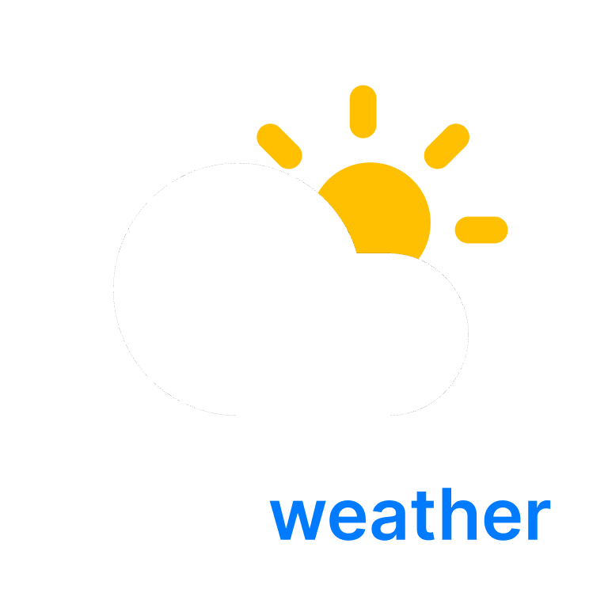

<p align="center">
  
</p>

<div align="center">

[](#) 

[](#) [](##) [](##) [](##) [](##) [](##) [](#)

[](#) [](#)

</div>

NativeWeather is a cross-platform weather app for Web and iOS, built with a Turborepo monorepo, Next.js, Expo, React Native, React Native Web, NativeWind, and shared app code.

This started as my first long-term project and has grown into a real weather product with forecasts, air quality, maps, alerts, favorites, local weather, settings, localization, and iOS widgets.

## Features

- Current weather with condition-based visuals
- 7-day forecast and hourly forecast
- Smart weather summary
- Weather alerts
- Air quality data with EU AQI and US AQI support
- Rain, snow, wind, humidity, UV, pressure, visibility, sunrise, sunset, moon, and cloud cards
- Search with suggestions and recent searches
- Favorite cities
- Local weather using device location
- Multiple weather data sources
- Light, dark, and system theme support
- Metric and imperial unit support
- Celsius and Fahrenheit support
- English and Czech localization with Tolgee
- Web support through Next.js and React Native Web
- iOS support through Expo Router
- iOS widgets with Expo Widgets
- Shared UI and business logic through `packages/app`

## Tech Stack

- Turborepo
- pnpm workspaces
- Next.js 16
- Expo SDK 55
- React 19
- React Native
- React Native Web
- Expo Router
- NativeWind
- Tailwind CSS
- Zustand
- React Native MMKV
- Tolgee
- OpenNext for Cloudflare
- TypeScript

## Monorepo Structure

```txt
nativeweather/
├── apps/
│   ├── web/          # Next.js web app
│   └── mobile/       # Expo mobile app
├── packages/
│   └── app/          # Shared app code, components, hooks, storage, API, types
├── package.json
├── pnpm-workspace.yaml
└── turbo.json
```

## Getting Started

Prerequisites

- Node.js
- pnpm
- Xcode for iOS development
- Expo tooling for mobile development

This project uses pnpm:

- pnpm install

Development
Run all development tasks through Turborepo:
pnpm dev
Run the web app:
pnpm --dir apps/web dev
Run the mobile app:
pnpm --dir apps/mobile dev
You can also use the root scripts:
pnpm web
pnpm mobile
