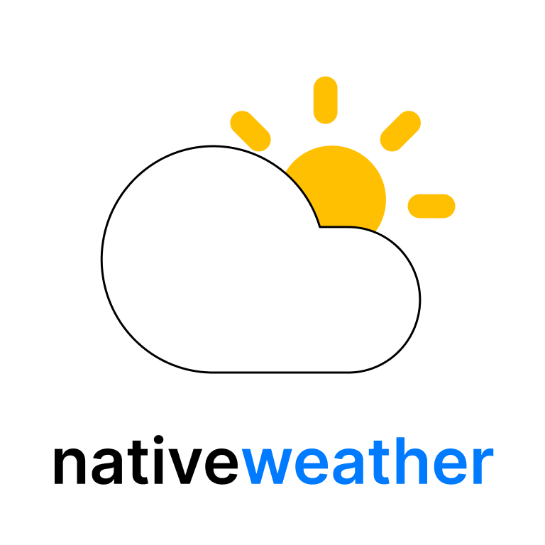
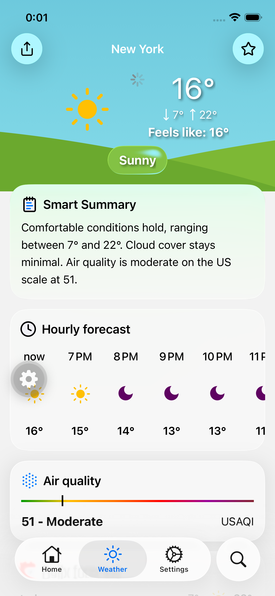
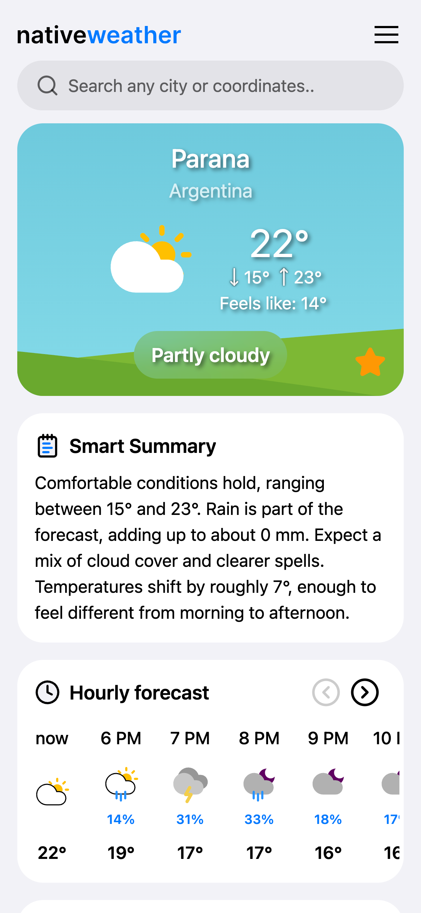

<p align="center">
  <picture>
    <source media="(prefers-color-scheme: dark)" srcset="packages/app/assets/readme/logo_dark.png" width="200">
    <source media="(prefers-color-scheme: light)" srcset="packages/app/assets/readme/logo_light.png" width="200">
    
  </picture>
</p>

<div align="center">

<!--  -->

[](https://nativeweather.app/) [](#) [](https://play.google.com/store/apps/details?id=YOUR_PACKAGE_NAME) [](https://your-link-here.com)

<!-- [](https://nativeweather.app/) -->

<!-- [](#) [](#) -->

<!-- [](https://expo.dev/) [](https://nextjs.org/)  -->

[](https://react.dev/) [](https://tailwindcss.com/) [](https://expo.dev/) [](https://nextjs.org/) [](https://www.typescriptlang.org/)

[](https://pnpm.io/) [](https://turbo.build/repo)

</div>

<div align="center">

&nbsp;
<!--  -->

&nbsp;

<!-- &nbsp;
 -->
</div>

<!-- <br/><br/>

<div align="center">

[](#)
[](https://nativeweather.app/)

[](#)
[](https://expo.dev/)
[](https://nextjs.org/)
[](https://react.dev/)
[](https://www.typescriptlang.org/)
[](https://tailwindcss.com/)

[](https://nativeweather.app/)
[](https://pnpm.io/)
[](https://code.visualstudio.com/)

</div> -->

<br/>

<div align="center">

NativeWeather is a cross-platform weather application for Web, iOS, Android and macOS
<br/><br/>
Built with Turborepo, Next.js, Expo, React Native, NativeWind, and shared app code in a monorepo PNPM workspace.

This started as my first long-term project and has grown into a real weather product with forecasts, air quality, maps, alerts, favorites, local weather, settings, localization, and iOS widgets.

</div>

- Visit the website: https://nativeweather.app
- Download on the App Store: https://appstore.apple.com
- Get it on Google Play: https://playstore.google.com
- Download the macOS app: https://nativeweather.pages.dev

## Features

- Current weather with condition-based visuals
- 7-day forecast and hourly forecast
- Smart weather summary
- Favorite cities
- Air quality data with EU AQI and US AQI support
- Weather alerts
- Light, dark, and system theme support
- English and Czech localization with Tolgee
- iOS widgets with Expo Widgets

## Tech Stack

- Turborepo
- pnpm workspaces
- Next.js 16
- Expo SDK 55
- React 19
- React Native
- React Native Web
- React Native macOS
- NativeWind
- React Native MMKV
- Tolgee

## Monorepo Structure

This is a monorepo project laced with Turborepo managed by PNPM workspaces connecting NextJS, Expo frameworks and bare React Native project with a shared code from packages/app folder

Many thanks to gurselcakar and his guide - https://www.gurselcakar.com/monorepo

<!-- <br/>
Universal React Monorepo template - https://github.com/gurselcakar/universal-react-monorepo -->

```txt
nativeweather/
├── apps/
│   ├── web/          # Next.js web app
│   └── mobile/       # Expo mobile app
│   └── macos/        # macOS desktop app
├── packages/
│   └── app/          # Shared app code, components, hooks, storage, API, types
├── package.json
├── pnpm-workspace.yaml
└── turbo.json
```

## Getting Started

Prerequisites

- Node.js
- PNPM
- Xcode for iOS and macOS development
- Expo tooling for mobile development

This project uses pnpm:

```txt
pnpm install
```

## Dev scripts

Run the web app:

```txt
pnpm web
```

Run the mobile app:

```txt
pnpm mobile
```

Run the Mac desktop app:

```txt
pnpm macos
```
